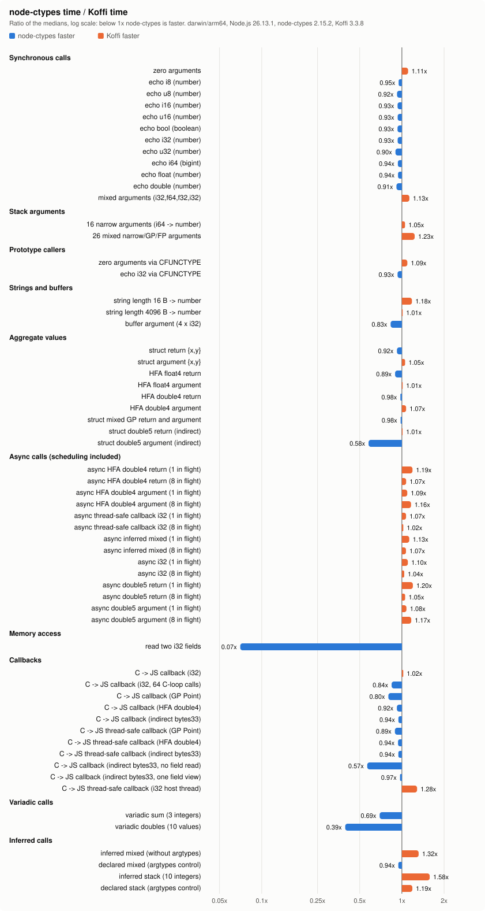
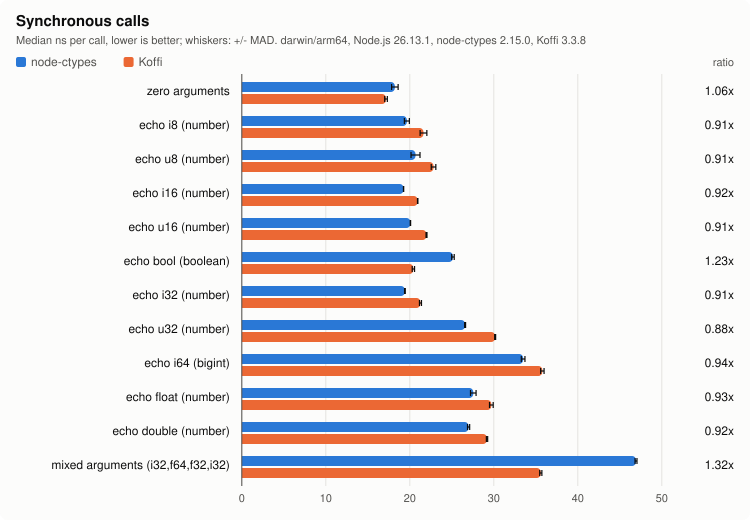
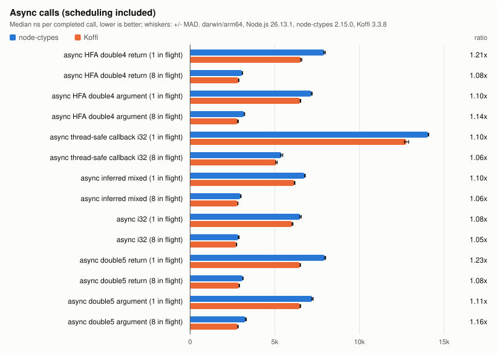
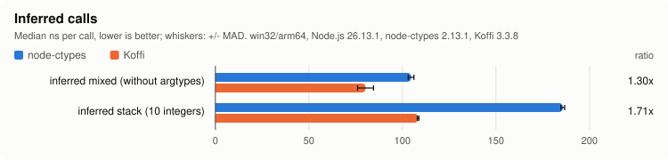

# Performance

The repository compares node-ctypes with [Koffi](https://koffi.dev/) and with
Node's experimental `node:ffi`, calling the same C functions with matching
native signatures. The results depend on the machine: run the comparisons on
yours with the commands in [Running the comparisons](#running-the-comparisons).

For a hot synchronous `paramflags` binding with only scalar inputs, pass all
arguments as positional numbers when that fits the call. With finite numbers
and no argument adapter, result conversion, or `errcheck` hook, the wrapper can
call the underlying binding directly. Named arguments, omitted defaults and
output parameters keep the behavior described under _Output parameters_ in
[Errors and results](errors.md).

In a callback that receives a struct by value, read a numeric array field once
if you need several elements. For an `array(c_uint8, 33)` field, for example,
`const bytes = value.bytes;` followed by `bytes[0] + bytes[32]` avoids
creating a second view. Both elements still come from the same callback
argument. Take the view from the current argument on each call.
Run `npm run bench:koffi -- --filter "C -> JS callback (indirect bytes33"`
to compare no field read, one view and two views on the same C fixture.

## Results

Measured on 2026-11-23 with node-ctypes 2.15.5, Koffi 3.3.8 and Node.js
26.13.1. Both addons ran natively on a physical MacBook Pro (Mac14,7) with an
Apple M2 (4 performance and 4 efficiency cores, 16 GB) running macOS 27.2.1.
The node-ctypes run used external buffers.

Median times in nanoseconds per call (asynchronous rows: per completed call,
scheduling included); the ratio is node-ctypes divided by Koffi, below 1 favors
node-ctypes.



### Synchronous calls



| Case                              | node-ctypes (ns) | Koffi (ns) | Ratio |
| --------------------------------- | ---------------: | ---------: | ----: |
| zero arguments                    |            18.83 |      16.66 | 1.13x |
| echo i8 (number)                  |            20.95 |      20.78 | 1.01x |
| echo u8 (number)                  |            21.40 |      21.61 | 0.99x |
| echo i16 (number)                 |            21.00 |      21.67 | 0.97x |
| echo u16 (number)                 |            21.84 |      21.77 | 1.00x |
| echo bool (boolean)               |            20.74 |      19.80 | 1.05x |
| echo i32 (number)                 |            21.30 |      20.96 | 1.02x |
| echo u32 (number)                 |            27.68 |      29.26 | 0.95x |
| echo i64 (bigint)                 |            33.58 |      35.04 | 0.96x |
| echo float (number)               |            27.36 |      28.29 | 0.97x |
| echo double (number)              |            27.13 |      28.15 | 0.96x |
| mixed arguments (i32,f64,f32,i32) |            39.35 |      34.98 | 1.12x |

### Stack arguments


| Case                                | node-ctypes (ns) | Koffi (ns) | Ratio |
| ----------------------------------- | ---------------: | ---------: | ----: |
| 16 narrow arguments (i64 -> number) |           101.19 |      98.11 | 1.03x |
| 26 mixed narrow/GP/FP arguments     |           182.38 |     180.17 | 1.01x |

### Prototype callers


| Case                         | node-ctypes (ns) | Koffi (ns) | Ratio |
| ---------------------------- | ---------------: | ---------: | ----: |
| zero arguments via CFUNCTYPE |            19.02 |      16.82 | 1.13x |
| echo i32 via CFUNCTYPE       |            21.29 |      20.97 | 1.02x |

### Strings and buffers


| Case                           | node-ctypes (ns) | Koffi (ns) | Ratio |
| ------------------------------ | ---------------: | ---------: | ----: |
| string length 16 B -> number   |            47.41 |      39.56 | 1.20x |
| string length 4096 B -> number |           245.07 |     239.99 | 1.02x |
| buffer argument (4 x i32)      |            24.48 |      30.07 | 0.81x |

In a separate node-ctypes-only comparison, a synchronous `strlen` binding took
either a JS string or `Buffer.from(text + "\0", "utf8")`. For 4096 bytes of
four-byte UTF-8 characters, preparing one buffer and passing it to four calls
reduced time per call by 60% on Windows, 83% on Ubuntu and 48% on Alpine in
the repeat run, **including buffer creation**. On Alpine, preparing a fresh
buffer for just one call was 88% slower. For 4096 bytes of ASCII or 16 bytes
of four-byte characters, the string was faster on all three systems at every
reuse count tested (1, 2, 4 and 8). Measure with the text and reuse count
your application actually has; byte length alone does not predict the winner.

Asynchronous `c_char_p` calls encode a JS string directly into memory owned by
that call. This removes an intermediate copy; it does not skip encoding when
you pass the same string again.

With direct encoding enabled, the same read-only `strlen` fixture was measured
with eight async calls in flight and 4096 bytes of four-byte UTF-8 characters.
Each group of eight passed the same JS string eight times or created a fresh
`Buffer.from(text + "\0", "utf8")` for every 1, 2, 4 or 8 calls. **Buffer
creation is included.** The table shows the change in time per completed call
in the repeat run (negative means the buffer was faster). This measures
throughput, not the latency of an individual call. The Windows column in this
table used x64 Node under emulation on ARM64; it is not a native Windows result.

| Calls per buffer | Windows | Ubuntu | Alpine |
| ---------------: | ------: | -----: | -----: |
|                1 |   +2.2% | −32.1% | +12.2% |
|                2 |  −26.3% | −40.2% | −16.3% |
|                4 |  −50.1% | −45.3% | −40.3% |
|                8 |  −53.2% | −45.5% | −40.3% |

Two calls per buffer was the first tested count that beat the string on all
three systems in both runs. With calls awaited **one at a time**, eight calls
per buffer saved only 10–13% in the repeat run. Neither 4096 bytes of ASCII nor
16 bytes of four-byte characters showed a consistent advantage across platforms
with eight calls in flight.

Even the same byte **and** character counts can give different results. A
follow-up on native ARM64 alternated strings and buffers in the same process,
again with eight calls in flight and buffer creation included. For 2048 copies
of `λ` (4096 UTF-8 bytes), using each buffer twice reduced time per completed
call in the repeat run by 19.9% on Windows, 34.3% on Ubuntu and 8.6% on Alpine.
For 2048 copies of `é`, the same comparison was 4.6% faster, 2.9% slower and
5.3% faster, respectively. Test representative text rather than converting
automatically at a particular size. Share a buffer only with a read-only
callee, and leave its contents unchanged until every call using it has settled.

### Aggregate values


| Case                                | node-ctypes (ns) | Koffi (ns) | Ratio |
| ----------------------------------- | ---------------: | ---------: | ----: |
| struct return {x,y}                 |            97.81 |     137.70 | 0.71x |
| struct argument {x,y}               |           111.19 |     117.71 | 0.94x |
| HFA float4 return                   |           108.29 |     176.71 | 0.61x |
| HFA float4 argument                 |           184.16 |     207.60 | 0.89x |
| HFA double4 return                  |           145.51 |     175.85 | 0.83x |
| HFA double4 argument                |           207.82 |     210.87 | 0.99x |
| struct mixed GP return and argument |           232.31 |     304.27 | 0.76x |
| struct double5 return (indirect)    |           125.80 |     190.72 | 0.66x |
| struct double5 argument (indirect)  |           198.83 |     238.26 | 0.83x |

### Async calls (scheduling included)



| Case                                         | node-ctypes (ns) | Koffi (ns) | Ratio |
| -------------------------------------------- | ---------------: | ---------: | ----: |
| async HFA double4 return (1 in flight)       |             7209 |       6266 | 1.15x |
| async HFA double4 return (8 in flight)       |             3049 |       2990 | 1.02x |
| async HFA double4 argument (1 in flight)     |             7051 |       6230 | 1.13x |
| async HFA double4 argument (8 in flight)     |             3070 |       2923 | 1.05x |
| async thread-safe callback i32 (1 in flight) |            13672 |      12624 | 1.08x |
| async thread-safe callback i32 (8 in flight) |             5358 |       5243 | 1.02x |
| async inferred mixed (1 in flight)           |             6521 |       5993 | 1.09x |
| async inferred mixed (8 in flight)           |             3029 |       2922 | 1.04x |
| async i32 (1 in flight)                      |             6144 |       5982 | 1.03x |
| async i32 (8 in flight)                      |             2867 |       2851 | 1.01x |
| async double5 return (1 in flight)           |             7334 |       6432 | 1.14x |
| async double5 return (8 in flight)           |             3054 |       3018 | 1.01x |
| async double5 argument (1 in flight)         |             7041 |       6301 | 1.12x |
| async double5 argument (8 in flight)         |             3115 |       2939 | 1.06x |

### Memory access


| Case                | node-ctypes (ns) | Koffi (ns) | Ratio |
| ------------------- | ---------------: | ---------: | ----: |
| read two i32 fields |             7.96 |     112.83 | 0.07x |

### Callbacks


| Case                                                | node-ctypes (ns) | Koffi (ns) | Ratio |
| --------------------------------------------------- | ---------------: | ---------: | ----: |
| C -> JS callback (i32)                              |           111.23 |     103.86 | 1.07x |
| C -> JS callback (i32, 64 C-loop calls)             |             3970 |       4632 | 0.86x |
| C -> JS callback (GP Point)                         |           181.91 |     226.72 | 0.80x |
| C -> JS callback (HFA double4)                      |           348.34 |     392.49 | 0.89x |
| C -> JS callback (indirect bytes33)                 |           357.29 |     386.07 | 0.93x |
| C -> JS thread-safe callback (GP Point)             |           193.14 |     226.32 | 0.85x |
| C -> JS thread-safe callback (HFA double4)          |           356.37 |     392.06 | 0.91x |
| C -> JS thread-safe callback (indirect bytes33)     |           358.52 |     386.67 | 0.93x |
| C -> JS callback (indirect bytes33, no field read)  |           205.90 |     375.89 | 0.55x |
| C -> JS callback (indirect bytes33, one field view) |           381.24 |     402.36 | 0.95x |
| C -> JS thread-safe callback (i32 host thread)      |           122.81 |     103.72 | 1.18x |

### Variadic calls


| Case                         | node-ctypes (ns) | Koffi (ns) | Ratio |
| ---------------------------- | ---------------: | ---------: | ----: |
| variadic sum (3 integers)    |            77.70 |      89.85 | 0.86x |
| variadic doubles (10 values) |           110.35 |     274.79 | 0.40x |

### Inferred calls



| Case                              | node-ctypes (ns) | Koffi (ns) | Ratio |
| --------------------------------- | ---------------: | ---------: | ----: |
| inferred mixed (without argtypes) |            52.81 |      41.21 | 1.28x |
| declared mixed (argtypes control) |            38.92 |      41.14 | 0.95x |
| inferred stack (10 integers)      |            88.18 |      57.64 | 1.53x |
| declared stack (argtypes control) |            68.75 |      57.58 | 1.19x |

Asynchronous rows include Promise completion; the two libraries use
different worker pools. Koffi 3.3.8 has no asynchronous entry for variadic
functions, so asynchronous variadic calls are not compared. Structure
arguments of callbacks are by-value copies with the same field values: ctypes
instances in node-ctypes, plain objects in Koffi.

## Running the comparisons

There are two JavaScript comparisons, both against another FFI library.
From the repository root, after building node-ctypes:

```bash
npm --prefix tests install             # includes Koffi
npm run build:test-fixture             # shared C functions for both libraries
npm run bench:koffi                    # node-ctypes vs Koffi; Node 24+
npm run bench:ffi                      # node-ctypes vs node:ffi; Node 26+
```

The private test package explicitly approves the install script for Koffi 3.3.8.
When upgrading Koffi, review the new version before updating that approval with
`npm --prefix tests install-scripts approve koffi`; future versions are not
automatically authorized.

`bench:ffi` adds `--experimental-ffi` automatically. Both comparisons
print a table grouped by workload and automatically generate HTML reports:

- `tests/benchmarks/results/koffi.html`
- `tests/benchmarks/results/node-ffi.html`

These paths are relative to the repository root, regardless of the working
directory. Each successful run replaces its previous report; generated results
are ignored by Git. Open the HTML file directly in a browser: it is responsive
and self-contained, with native HTML/CSS bar charts and no browser JavaScript,
external resources or server requirements.

| Column                   | Meaning                                               |
| ------------------------ | ----------------------------------------------------- |
| Case                     | The same operation and inputs for both libraries      |
| node-ctypes / competitor | Median time +/- MAD (dispersion), in ns per operation |
| Ratio                    | node-ctypes time divided by competitor time           |

A ratio of `0.50x` means node-ctypes took half the time; `2.00x` means it
took twice the time. Lower times are better. There is no overall score
combining unrelated calls, memory access and asynchronous scheduling.
In the charts, **shorter bars are better**. Each workload group shares a linear
scale starting at zero; different groups use different scales. Bars show
medians, with +/- MAD whiskers (not confidence intervals). Each library also
shows its total measured operation count and elapsed time across the samples.

Reports record library/runtime versions, CPU, OS/kernel, buffer mode, start/
finish timestamps and Git revision/working-tree status. Missing CPU or Git
metadata produces an explicit warning rather than invented values.

Both comparisons cover narrow scalars, mixed GP/FP stack arguments, short/long
strings, buffer arguments, field reads, scalar callbacks and 64-callback C loops.
The node:ffi comparison includes 25 workloads. Koffi also covers structures by value,
variadic calls and async calls with 1/8 calls in flight. Cases without an
equivalent documented node:ffi API are listed as **not compared**, not
emulated with a different native signature.

Inferred rows omit node-ctypes `argtypes`, while both competitors use explicit
fixed signatures for the same C functions: these rows include node-ctypes
inference overhead, not equivalent automatic-inference APIs.
To measure the cost of omitting `argtypes`, run
`npm run bench:koffi -- --filter "without argtypes,inferred stack,argtypes control"`.
Compare the **node-ctypes** times within each pair: both bindings call the same
C function with the same values and return type. In a separate paired measurement
on Windows, Ubuntu and Alpine, omitting the types for `(int32, double, int32)`
took 14–18% longer in the repeat run. The ten-integer case did not show a
consistent penalty across platforms.

The node:ffi bool row passes numeric `1` and compares normalized Number results:
node:ffi represents bool arguments/results as uint8 values, whereas node-ctypes
returns a JavaScript Boolean. Koffi's bool row uses Boolean input/output.
The thread-safe scalar callback rows measure node-ctypes dispatch on its host
thread against a competitor callback on the same thread, not cross-thread handoff.
The C-loop times are per batch of 64 completed callbacks, not per callback.

The `CFUNCTYPE` rows measure calls through an already-bound node-ctypes
prototype, against an independently bound competitor function with the same
C signature. Bindings are separate to avoid sharing optimization feedback
with the direct-call rows. These cases do not include prototype construction
or callback registration.

Both sides call the same C fixture and verify results before/after timing.
String contents are encoded on every call; node-ctypes reuses scratch storage,
not previously encoded strings. Measurements describe warmed repeated calls,
not cold-start allocation costs.
String lengths, narrow/inferred-stack i64 results and C-loop sums are compared
as Numbers, including conversion where the API returns BigInt; wide integers
are BigInt in both APIs. Structures are plain
objects. Async times include scheduling and are reported per completed call,
with the concurrency shown in the case name. With one call in flight, the
runner awaits each Promise before submitting the next call. With eight, it
submits a batch and waits for all eight before starting another. The latter
number measures throughput, not the latency of an individual call. Run
`npm run bench:koffi -- --filter "async i32 ("` to compare the two on the same
declared scalar signature.

Defaults are nine samples of at least 250 ms per library after warmup,
alternating library order. Each native signature has a separate call-site to
avoid mixing V8 optimization feedback between cases.
Each row is printed when its measurements finish.
Run comparisons serially, not concurrently. Optional arguments:

```bash
npm run bench:koffi -- --filter string,callback
npm run bench:ffi -- --samples 11 --duration 500
npm run bench:koffi -- --output comparison.json
```

`--output comparison.json` additionally saves medians, dispersion and all sample
durations/operation counts as JSON, and writes `comparison.html` next to it
instead of the default HTML report. Parent directories are created automatically.
HTML generation runs only after all measurements finish.
`benchmark_koffi.js` and `benchmark_node_ffi.js` define the actual side-by-side
comparisons; `runner.js` shares timing, table output and HTML generation without
extra dependencies or a separate renderer script. Benchmarks are not run by the
functional/parity test suite.

The charts on this page are static SVG files generated from such a JSON report:

```bash
npm run bench:koffi -- --output comparison.json
npm run bench:charts -- comparison.json                # writes guides/images/
npm run bench:charts -- comparison.json --out charts   # another directory
```

`charts.js` writes `<competitor>-summary.svg` (the ratio of every case) and one
`<competitor>-<group>.svg` per workload group (medians with +/- MAD whiskers),
with light and dark colors; the tables are not regenerated. The steps to
replace the published results are in the
[benchmarks guide](../tests/benchmarks/README.md#updating-the-published-results).
