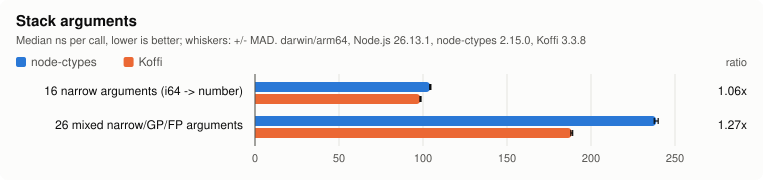
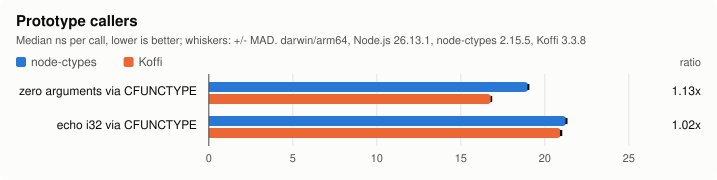
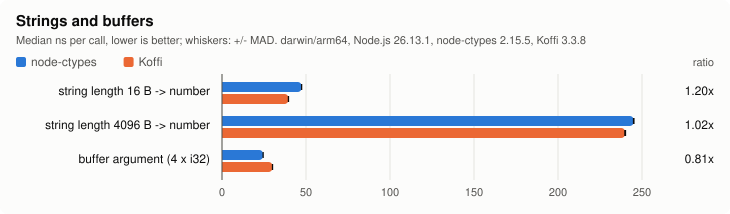
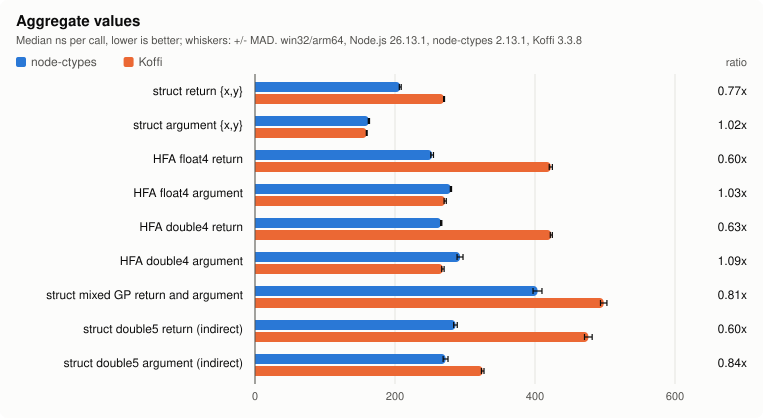
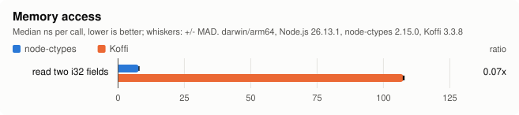
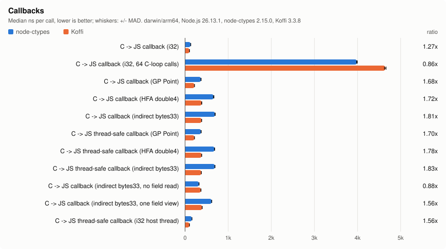

# Performance

The repository compares node-ctypes with [Koffi](https://koffi.dev/) and with
Node's experimental `node:ffi`, calling the same C functions with matching
native signatures. The results depend on the machine: run the comparisons on
yours with the commands in [Running the comparisons](#running-the-comparisons).

## Results

node-ctypes vs Koffi 3.3.8, node-ctypes 2.13.1, Node.js 26.13.1,
Windows 11 ARM64 in a Parallels virtual machine on Apple Silicon (not native
hardware), 2026-11-14. Median times in nanoseconds per call (asynchronous rows:
per completed call, scheduling included); the ratio is node-ctypes divided by
Koffi, below 1 favors node-ctypes.


### Synchronous calls


| Case                              | node-ctypes (ns) | Koffi (ns) | Ratio |
| --------------------------------- | ---------------: | ---------: | ----: |
| zero arguments                    |            51.17 |      40.99 | 1.25x |
| echo i8 (number)                  |            65.69 |      54.16 | 1.21x |
| echo u8 (number)                  |            67.67 |      55.92 | 1.21x |
| echo i16 (number)                 |            65.46 |      53.90 | 1.21x |
| echo u16 (number)                 |            67.61 |      55.13 | 1.23x |
| echo bool (boolean)               |            62.62 |      51.05 | 1.23x |
| echo i32 (number)                 |            60.84 |      54.03 | 1.13x |
| echo u32 (number)                 |            79.95 |      71.66 | 1.12x |
| echo i64 (bigint)                 |           122.46 |     118.94 | 1.03x |
| echo float (number)               |            80.85 |      70.36 | 1.15x |
| echo double (number)              |            79.43 |      70.57 | 1.13x |
| mixed arguments (i32,f64,f32,i32) |           114.48 |     107.42 | 1.07x |

### Stack arguments



| Case                                | node-ctypes (ns) | Koffi (ns) | Ratio |
| ----------------------------------- | ---------------: | ---------: | ----: |
| 16 narrow arguments (i64 -> number) |           231.52 |     171.81 | 1.35x |
| 26 mixed narrow/GP/FP arguments     |           336.83 |     311.13 | 1.08x |

### Prototype callers



| Case                         | node-ctypes (ns) | Koffi (ns) | Ratio |
| ---------------------------- | ---------------: | ---------: | ----: |
| zero arguments via CFUNCTYPE |            51.14 |      41.13 | 1.24x |
| echo i32 via CFUNCTYPE       |            60.79 |      56.70 | 1.07x |

### Strings and buffers



| Case                           | node-ctypes (ns) | Koffi (ns) | Ratio |
| ------------------------------ | ---------------: | ---------: | ----: |
| string length 16 B -> number   |           112.98 |      73.44 | 1.54x |
| string length 4096 B -> number |             1551 |       1464 | 1.06x |
| buffer argument (4 x i32)      |            73.57 |      68.27 | 1.08x |

### Aggregate values



| Case                                | node-ctypes (ns) | Koffi (ns) | Ratio |
| ----------------------------------- | ---------------: | ---------: | ----: |
| struct return {x,y}                 |           207.51 |     270.08 | 0.77x |
| struct argument {x,y}               |           162.72 |     159.64 | 1.02x |
| HFA float4 return                   |           253.01 |     422.57 | 0.60x |
| HFA float4 argument                 |           279.91 |     271.69 | 1.03x |
| HFA double4 return                  |           266.01 |     423.31 | 0.63x |
| HFA double4 argument                |           292.92 |     268.42 | 1.09x |
| struct mixed GP return and argument |           403.58 |     498.14 | 0.81x |
| struct double5 return (indirect)    |           286.36 |     476.18 | 0.60x |
| struct double5 argument (indirect)  |           272.24 |     325.31 | 0.84x |

### Async calls (scheduling included)


| Case                                         | node-ctypes (ns) | Koffi (ns) | Ratio |
| -------------------------------------------- | ---------------: | ---------: | ----: |
| async HFA double4 return (1 in flight)       |            29302 |      27327 | 1.07x |
| async HFA double4 return (8 in flight)       |             7519 |       6114 | 1.23x |
| async HFA double4 argument (1 in flight)     |            31434 |      28966 | 1.09x |
| async HFA double4 argument (8 in flight)     |             4962 |       3908 | 1.27x |
| async thread-safe callback i32 (1 in flight) |            53216 |      52290 | 1.02x |
| async thread-safe callback i32 (8 in flight) |             8901 |       7433 | 1.20x |
| async inferred mixed (1 in flight)           |            28974 |      28805 | 1.01x |
| async inferred mixed (8 in flight)           |             4699 |       3900 | 1.20x |
| async i32 (1 in flight)                      |            29974 |      28914 | 1.04x |
| async i32 (8 in flight)                      |             6272 |       4140 | 1.52x |
| async double5 return (1 in flight)           |            31862 |      30957 | 1.03x |
| async double5 return (8 in flight)           |             5726 |       5276 | 1.09x |
| async double5 argument (1 in flight)         |            31129 |      28881 | 1.08x |
| async double5 argument (8 in flight)         |             7566 |       5681 | 1.33x |

### Memory access



| Case                | node-ctypes (ns) | Koffi (ns) | Ratio |
| ------------------- | ---------------: | ---------: | ----: |
| read two i32 fields |             9.60 |     195.85 | 0.05x |

### Callbacks



| Case                                            | node-ctypes (ns) | Koffi (ns) | Ratio |
| ----------------------------------------------- | ---------------: | ---------: | ----: |
| C -> JS callback (i32)                          |           223.15 |     196.90 | 1.13x |
| C -> JS callback (i32, 64 C-loop calls)         |             5134 |       5714 | 0.90x |
| C -> JS callback (GP Point)                     |           723.98 |     405.26 | 1.79x |
| C -> JS callback (HFA double4)                  |           934.30 |     552.57 | 1.69x |
| C -> JS callback (indirect bytes33)             |             1065 |     557.24 | 1.91x |
| C -> JS thread-safe callback (GP Point)         |           564.87 |     390.55 | 1.45x |
| C -> JS thread-safe callback (HFA double4)      |           933.45 |     540.14 | 1.73x |
| C -> JS thread-safe callback (indirect bytes33) |             1139 |     637.58 | 1.79x |
| C -> JS thread-safe callback (i32 host thread)  |           249.99 |     175.90 | 1.42x |

### Variadic calls


| Case                         | node-ctypes (ns) | Koffi (ns) | Ratio |
| ---------------------------- | ---------------: | ---------: | ----: |
| variadic sum (3 integers)    |           215.32 |     159.84 | 1.35x |
| variadic doubles (10 values) |           263.17 |     359.78 | 0.73x |

### Inferred calls


| Case                              | node-ctypes (ns) | Koffi (ns) | Ratio |
| --------------------------------- | ---------------: | ---------: | ----: |
| inferred mixed (without argtypes) |           104.63 |      80.31 | 1.30x |
| inferred stack (10 integers)      |           185.74 |     108.40 | 1.71x |

Asynchronous rows include Promise completion; the two libraries use
different worker pools. Koffi 3.3.8 has no asynchronous entry for variadic
functions, so asynchronous variadic calls are not compared. Structure
arguments of callbacks are by-value copies with the same field values: ctypes
instances in node-ctypes, plain objects in Koffi.

## Running the comparisons

There are two JavaScript comparisons, both against another FFI library.
From the repository root, after building node-ctypes:

```bash
npm --prefix tests install             # includes Koffi
npm run build:test-fixture             # shared C functions for both libraries
npm run bench:koffi                    # node-ctypes vs Koffi; Node 24+
npm run bench:ffi                      # node-ctypes vs node:ffi; Node 26+
```

The private test package explicitly approves the install script for Koffi 3.3.8.
When upgrading Koffi, review the new version before updating that approval with
`npm --prefix tests install-scripts approve koffi`; future versions are not
automatically authorized.

`bench:ffi` adds `--experimental-ffi` automatically. Both comparisons
print a table grouped by workload and automatically generate HTML reports:

- `tests/benchmarks/results/koffi.html`
- `tests/benchmarks/results/node-ffi.html`

These paths are relative to the repository root, regardless of the working
directory. Each successful run replaces its previous report; generated results
are ignored by Git. Open the HTML file directly in a browser: it is responsive
and self-contained, with native HTML/CSS bar charts and no browser JavaScript,
external resources or server requirements.

| Column                   | Meaning                                               |
| ------------------------ | ----------------------------------------------------- |
| Case                     | The same operation and inputs for both libraries      |
| node-ctypes / competitor | Median time +/- MAD (dispersion), in ns per operation |
| Ratio                    | node-ctypes time divided by competitor time           |

A ratio of `0.50x` means node-ctypes took half the time; `2.00x` means it
took twice the time. Lower times are better. There is no overall score
combining unrelated calls, memory access and asynchronous scheduling.
In the charts, **shorter bars are better**. Each workload group shares a linear
scale starting at zero; different groups use different scales. Bars show
medians, with +/- MAD whiskers (not confidence intervals). Each library also
shows its total measured operation count and elapsed time across the samples.

Reports record library/runtime versions, CPU, OS/kernel, buffer mode, start/
finish timestamps and Git revision/working-tree status. Missing CPU or Git
metadata produces an explicit warning rather than invented values.

Both comparisons cover narrow scalars, mixed GP/FP stack arguments, short/long
strings, buffer arguments, field reads, scalar callbacks and 64-callback C loops.
The node:ffi comparison includes 25 workloads. Koffi also covers structures by value,
variadic calls and async calls with 1/8 calls in flight. Cases without an
equivalent documented node:ffi API are listed as **not compared**, not
emulated with a different native signature.

Inferred rows omit node-ctypes `argtypes`, while both competitors use explicit
fixed signatures for the same C functions: these rows include node-ctypes
inference overhead, not equivalent automatic-inference APIs.
The node:ffi bool row passes numeric `1` and compares normalized Number results:
node:ffi represents bool arguments/results as uint8 values, whereas node-ctypes
returns a JavaScript Boolean. Koffi's bool row uses Boolean input/output.
The thread-safe scalar callback rows measure node-ctypes dispatch on its host
thread against a competitor callback on the same thread, not cross-thread handoff.
The C-loop times are per batch of 64 completed callbacks, not per callback.

The `CFUNCTYPE` rows measure calls through an already-bound node-ctypes
prototype, against an independently bound competitor function with the same
C signature. Bindings are separate to avoid sharing optimization feedback
with the direct-call rows. These cases do not include prototype construction
or callback registration.

Both sides call the same C fixture and verify results before/after timing.
String contents are encoded on every call; node-ctypes reuses scratch storage,
not previously encoded strings. Measurements describe warmed repeated calls,
not cold-start allocation costs.
String lengths, narrow/inferred-stack i64 results and C-loop sums are compared
as Numbers, including conversion where the API returns BigInt; wide integers
are BigInt in both APIs. Structures are plain
objects. Async times include scheduling and are reported per completed call,
with the concurrency shown in the case name.

Defaults are nine samples of at least 250 ms per library after warmup,
alternating library order. Each native signature has a separate call-site to
avoid mixing V8 optimization feedback between cases.
Each row is printed when its measurements finish.
Run comparisons serially, not concurrently. Optional arguments:

```bash
npm run bench:koffi -- --filter string,callback
npm run bench:ffi -- --samples 11 --duration 500
npm run bench:koffi -- --output comparison.json
```

`--output comparison.json` additionally saves medians, dispersion and all sample
durations/operation counts as JSON, and writes `comparison.html` next to it
instead of the default HTML report. Parent directories are created automatically.
HTML generation runs only after all measurements finish.
`benchmark_koffi.js` and `benchmark_node_ffi.js` define the actual side-by-side
comparisons; `runner.js` shares timing, table output and HTML generation without
extra dependencies or a separate renderer script. Benchmarks are not run by the
functional/parity test suite.

The charts on this page are static SVG files generated from such a JSON report:

```bash
npm run bench:koffi -- --output comparison.json
npm run bench:charts -- comparison.json                # writes guides/images/
npm run bench:charts -- comparison.json --out charts   # another directory
```

`charts.js` writes `<competitor>-summary.svg` (the ratio of every case) and one
`<competitor>-<group>.svg` per workload group (medians with +/- MAD whiskers),
with light and dark colors; the tables are not regenerated. The steps to
replace the published results are in the
[benchmarks guide](../tests/benchmarks/README.md#updating-the-published-results).
